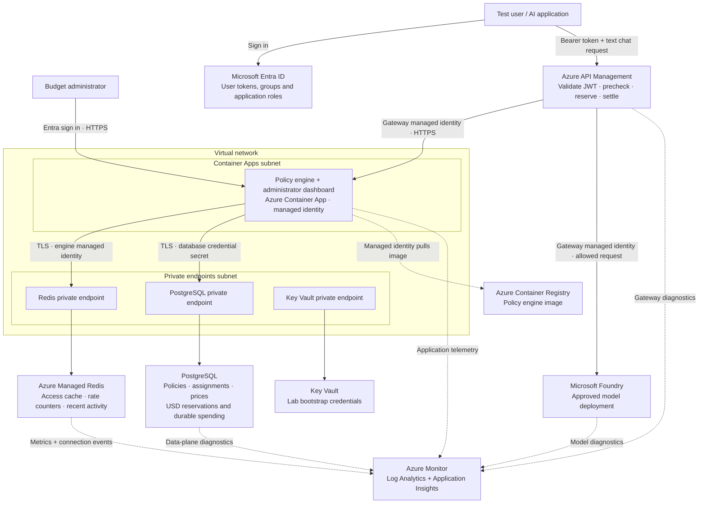
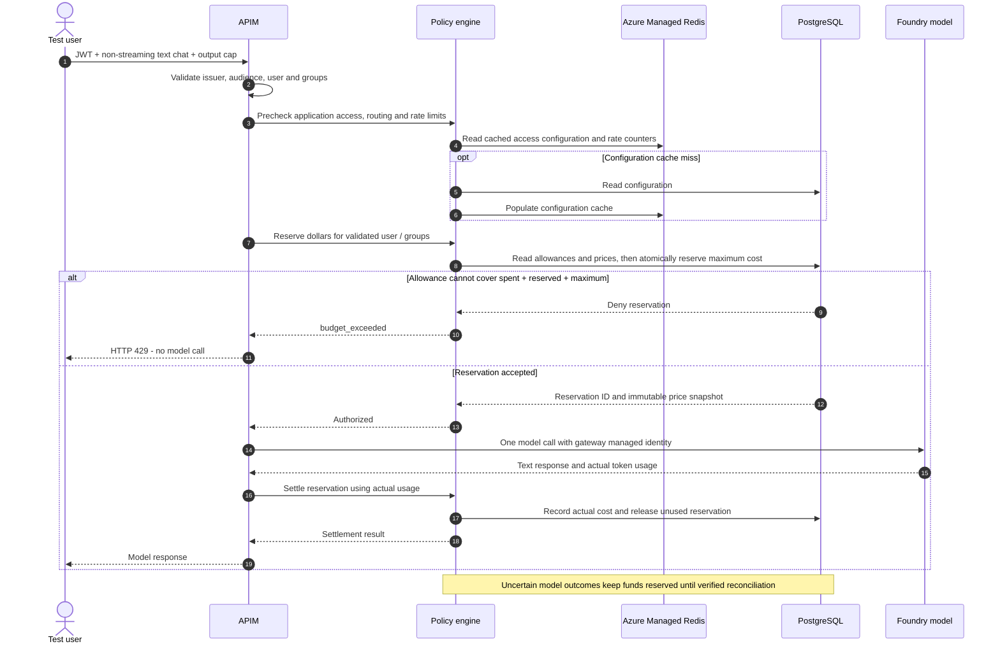

# Architecture and request flow

This POC gives an Entra user or group a weekly or monthly allowance, such as **$50 per calendar month**, for AI requests through Azure API Management (APIM). The policy engine decides whether a request fits the allowance. PostgreSQL records the reservation and final cost. Azure Managed Redis supports access checks, rate controls and activity views.

## Solution architecture

Private DNS zones resolve the Redis, PostgreSQL and Key Vault hostnames to their private endpoints. APIM and the engine expose HTTPS endpoints in this POC; caller and gateway authorization protect the application. Foundry's model endpoint is reached by APIM with its managed identity. Key Vault supports lab provisioning; it is not called for every inference request. Terraform writes lab credentials through the ARM control plane, while their data-plane retrieval requires private connectivity.

## What happens for one request

APIM uses separate calls for access precheck, dollar authorization and settlement. Redis is contacted during the precheck and supporting cache/activity operations. Every request reaching dollar authorization contacts PostgreSQL, even with a warm Redis cache. Successful responses trigger a second PostgreSQL accounting operation. The dollar ledger does not rely on Redis counters, cache TTLs or distributed locks.

## Example: a $50 monthly allowance

A user starts with $0 spent and $0 reserved. Suppose a request's conservative maximum cost is $0.06. PostgreSQL first records that reservation. If actual usage costs $0.002, settlement increases spending to $0.002 and releases the $0.06 reservation. Remaining allowance is $49.998. These amounts illustrate the flow; actual charges depend on the configured model prices and reported usage.

A later request is blocked when `spent + outstanding reservations + maximum request cost > $50`. Blocking can occur before actual spending reaches $50 because the remaining allowance must cover the worst allowed request. Monthly windows start at 00:00 UTC on the first of the month; weekly windows start Monday at 00:00 UTC. Policies can apply to a user, a shared group bucket, or a separate allowance per member.

## Redis deployment options

| Option | Terraform configuration | Result |
|---|---|---|
| Create Azure Managed Redis (default) | `create_redis = true` | Creates a Managed Redis instance, private endpoint, private DNS zone/link, diagnostics and engine identity data access. |
| Bring existing Redis | `create_redis = false` plus `existing_redis_connection_string` | Creates no Redis resources. Customer provides a reachable cache, DNS and engine data access. |
| Run without any Redis service | Not supported by this engine | Access checks, rate counters and activity services currently require Redis. Terraform rejects an empty existing connection when creation is disabled. |

`redis_location` defaults to the main deployment region; override it when subscription restrictions or capacity require another region. The private endpoint remains in the engine VNet region. Cross-region cache access adds latency and may add network charges.

The default SKU is `Balanced_B0`, with high availability disabled for the POC. Set `redis_high_availability_enabled = true` for replicas. The database uses TLS, disabled access keys, Entra authentication, `NoCluster` for compatibility and `NoEviction` to avoid silently evicting active counters. Monitor cache memory and size it for the workload. The engine automatically refreshes Entra authentication through its Redis client integration.

For an existing Managed Redis instance, use the ordinary service hostname and TLS port, for example `mycache.swedencentral.redis.azure.net:10000,ssl=True,abortConnect=False`. Grant the engine managed identity **Redis data access** through the cache's authentication settings; management-plane Contributor alone is insufficient. Use a non-clustered cache for the supported POC configuration. Password-backed existing Redis is also accepted when a password is supplied in the connection string.

## Where to see usage

1. Open the `dashboard_url` Terraform output and sign in as the configured administrator.
2. Open **Budgets**, enter the tenant ID and select **Load budgets**.
3. Inspect the $50 policy, its user/group assignment, spending, reserved amounts and remaining allowance.
4. Run `node scripts/lab/e2e-budget.mjs --device-code --verify-block` for a real user-authenticated model call and budget-block verification. Its temporary reduced allowance is restored to $50.

PostgreSQL contains the authoritative financial records. Redis metrics show cache health and activity, not the user's durable USD allowance. Azure Cost Management shows Azure infrastructure/invoice costs, which are separate from this application's price-book accounting.

For resource purposes and limitations, see [Solution](SOLUTION.md). For deployment, existing-platform prerequisites and interactive testing, see [Azure budget lab](AZURE_BUDGET_LAB.md).
