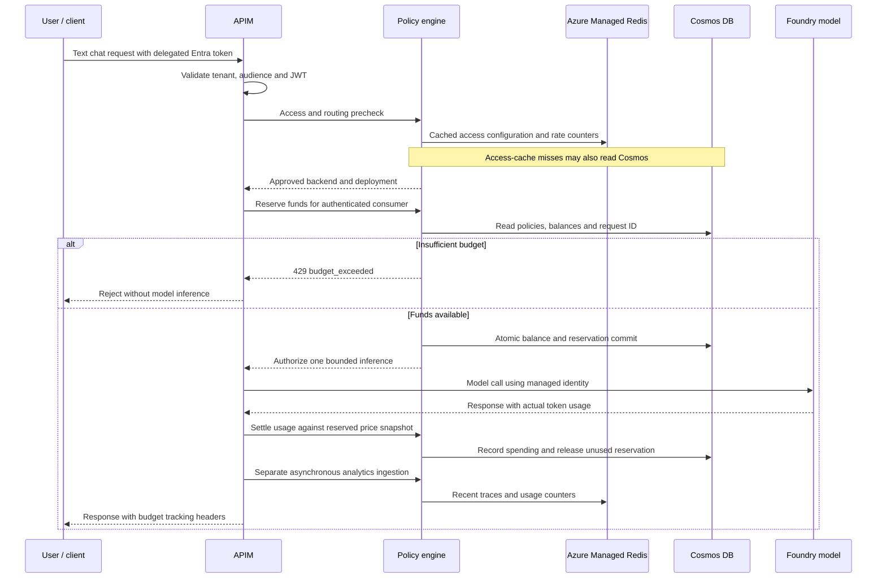

# Solution: per-consumer dollar budgets for AI through APIM

## Purpose

This POC lets an administrator assign a USD allowance to a user, application or group and enforce it before an AI model is invoked. The default demonstration is **$50 per calendar month for one Entra test user**. Weekly and monthly policies can be configured together; all applicable allowances must have sufficient funds.

The allowance is monetary. Model token counts are used to calculate cost, rather than being the allowance itself. The separate access plan disables token-allowance enforcement in the demonstration, while retaining deployment access and rate controls.

## Architecture and request flow

See [Architecture](ARCHITECTURE.md) for the component diagram, numbered flow, Redis deployment options and $50 example.



The user signs in through Entra, including MFA when required. APIM extracts identity from the validated token, not caller-supplied identity headers. APIM authenticates its calls to the engine using managed identity and the `AIPolicy.Apim` app role. It invokes the approved Foundry endpoint using a separate Azure RBAC grant to its managed identity.

The engine checks application access and routing before reserving dollars. Every request reaching budget authorization reads Cosmos. Redis does not authorize dollar spending. Successful inference is followed by another Cosmos accounting operation to settle actual cost.

## How the monetary ceiling works

For every matching allowance, the admission condition is:

```text
spent USD + reserved USD + maximum new request USD <= allowance USD
```

The reservation uses the deployment's **full configured hard input bound** and the request's explicit output cap, priced at uncached input and output rates. It is intentionally conservative: a request may be blocked while money remains because that money cannot cover the maximum possible request cost. Correct backend bounds, approved prices and protection of all inference routes are prerequisites for enforcement.

Settlement calculates actual cost from input, cached-input and output counts using the immutable price snapshot saved with the reservation. Decimal amounts are rounded up to nine decimal places. Unused reserved money is released. The configured price book governs the allowance debit; this is not an exact Azure invoice or a cap on infrastructure charges.

Cosmos stores policy configuration, period balances and reservations in the `configuration` container under partition `budget:{tenantId}`. ETag-guarded transactional batches update all applicable allowances together. The account must have one write region and financial records must not expire automatically. Conflicting updates are retried; exhausted retries deny the request rather than authorize uncommitted spending.

Each reservation authorizes one backend attempt. Duplicate reservation IDs cannot authorize another inference. Matching settlement retries do not charge twice. Timeouts or missing usage retain the reservation because a provider charge may still have occurred. Administrators reconcile pending reservations using verified usage and an evidence note.

## Assignment and reset behavior

| Assignment | Allowance |
|---|---|
| User | One bucket for the user's object ID |
| Application | One bucket for the application's client ID |
| Group — per member | Independent bucket per member; the same policy through multiple groups does not multiply the user's allowance |
| Group — shared | One pool consumed by the group's members |
| Weekly and monthly together | Both must cover the request |

Monthly periods start on the first day at 00:00 UTC. Weekly periods start Monday at 00:00 UTC. Late settlement belongs to the original reservation period. These are calendar periods, not rolling windows.

Group assignment uses security-group claims in the token. Missing or overage group claims deny delegated requests when group policies exist. Automatic Graph membership resolution is not implemented. Application-only tokens cannot impersonate a user's allowance.

## Azure resources and their purposes

Names derive from `name_prefix`; the customer configuration chooses its own subscription, tenant, region and resource group. No environment-specific credentials are included in the repository.

| Resource | Purpose |
|---|---|
| Resource group | Application infrastructure lifecycle boundary |
| API Management, budget API/operation/policy | Authenticated AI entry point; access precheck, reservation, one model invocation and settlement |
| Foundry AI Services account | Model endpoint with local keys disabled |
| Foundry project | Project container for the POC; can be skipped when reusing an account |
| GPT-4.1-mini model deployment | Default inference workload, alias `budget-chat` |
| Policy engine Container App | ASP.NET backend and React administrator dashboard |
| Azure Managed Redis (creation optional) | Managed cache, rate counters, recent traces and legacy usage coordination; private endpoint, TLS and engine Entra data access |
| Container Apps environment | VNet-connected Consumption hosting for the engine |
| Azure Container Registry | Remote image build and private image storage |
| Cosmos DB account, `aipolicy` database, three containers | Durable configuration, budgets, audit logs and billing summaries |
| Key Vault and lab secrets | Bootstrap secret and test-user password storage |
| Virtual network and two subnets | Connectivity for apps and private endpoints |
| Redis, Cosmos and Key Vault private endpoints, NICs, DNS zones/links | Access services whose public networking is disabled |
| Managed identities and RBAC grants | App image pull, Cosmos data access, model discovery and APIM inference without embedded service credentials |
| Log Analytics, Application Insights and diagnostics | Application and infrastructure troubleshooting; budget data is viewed through the engine |
| Azure-created environment infrastructure | Container Apps may create a separate managed resource group containing ingress networking |
| Entra applications and service principals | Engine/dashboard API, gateway audience, public test client and bootstrap automation |
| Entra scopes, consent, app-role grants and test user | Delegated test access, admin dashboard access and trusted gateway accounting |

Entra objects are tenant-scoped and are not members of the Azure resource group. The hosting platform or tenant policies may add alerts or network controls beyond the explicit Terraform modules.

## Customer demonstration and where to see results

Follow [POC deployment and testing](AZURE_BUDGET_LAB.md). Deployment ends after the application is ready and the $50 policy is configured. The separate interactive test prompts for the test user's sign-in and honors MFA.

On success, the test shows provider token counts, request cost, total spending, remaining allowance, period reset and the budget-block result. It temporarily reduces only the demonstration allowance to prove rejection, restores $50, and writes a credential-free local report. It does not fabricate spending or consume $50 just to prove blocking.

In the dashboard, sign in as the configured administrator, open **Budgets**, enter the tenant ID and choose **Load budgets**. Inspect policies, assignments, current balances and pending reservations. Balance records appear after reservations are first created. APIM's policy editor shows enforcement; `X-Budget-Request-Id` links a response to its reservation, and `X-Budget-Settlement` shows settled versus pending reconciliation.

Azure Cost Management reports provider and infrastructure charges separately. The Cosmos ledger displayed by the dashboard is the allowance authority.

## Scope and production considerations

Supported requests are non-streaming text Chat Completions, one completion and exactly one explicit output cap. Streaming, Responses, tools, image/audio requests and automatic provider-log reconciliation are not implemented.

The POC includes existing access/routing/analytics code because the budget policy uses those services. Other administrator screens may expose those supporting features. Their legacy pricing is separate from the approved **Budgets** price book.

Default Azure Managed Redis is a small Balanced_B0 instance with high availability disabled for POC cost. Enable replicas using `redis_high_availability_enabled=true`. `create_redis=false` requires an existing reachable Redis service; running with no Redis is not supported. See [architecture and request flow](ARCHITECTURE.md) for diagrams and cache configuration. Budget administration uses the application's global admin role, not per-tenant delegated admin isolation. One tenant partition serializes financial updates: load-test contention, partition capacity and ledger growth before production. Archive and recovery designs must preserve duplicate protection and active financial records.

Only the protected APIM routes should be reachable by model consumers; restrict direct model access and audit inherited/operation policies. Review model price changes, request bounds, identity permissions, monitoring, retention and reconciliation procedures for a production rollout. Financial state must be protected and backed up.

See [budget operations and API contract](USD_BUDGETS.md) for detailed administration and reconciliation.
